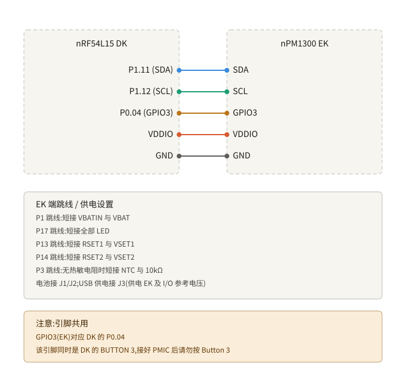
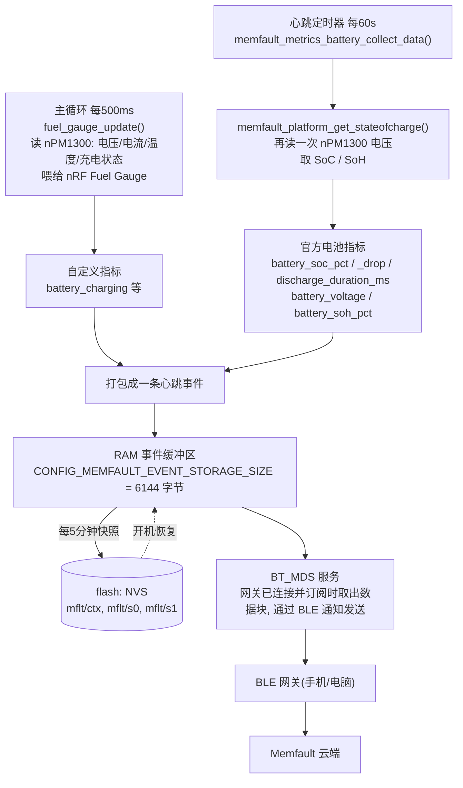

# pmic_memfault_demo

**nRF54L15 DK + 标准 nPM1300 EK:BLE LED/Button 服务 + 通过蓝牙把电池数据上报到 Memfault**

基于 nRF Connect SDK **v3.4.0**(Zephyr 4.4.2)。在 Nordic 的 `npm13xx_fuel_gauge` 示例上并入了 `peripheral_lbs`(LED Button Service)和 Memfault Diagnostic Service(MDS),
设备本身不联网,Memfault 数据通过 BLE 交给手机/电脑网关再转发到 Memfault 云端。工程由作者在 nRF54L15 DK + 标准 nPM1300 EK 上测试。

> **使用前必须做的一件事**:`prj.conf` 里的 `CONFIG_MEMFAULT_NCS_PROJECT_KEY` 是占位符 `<YOUR_MEMFAULT_PROJECT_KEY>`,
> 请换成你自己 Memfault 项目的 Project Key(Memfault 项目 Settings 里),否则网关拿到的上传凭据是无效的。

## 目录

1. [功能概览](#1-功能概览)
2. [硬件与接线](#2-硬件与接线)
3. [编译、烧录与使用](#3-编译烧录与使用)
4. [Memfault 数据是怎么上报的](#4-memfault-数据是怎么上报的)
5. [数据(Log)是怎么保存的](#5-数据log是怎么保存的)
6. [上报周期一览](#6-上报周期一览)
7. [prj.conf 里每个宏的作用](#7-prjconf-里每个宏的作用)
8. [代码里的宏与自定义指标](#8-代码里的宏与自定义指标)
9. [已知限制与注意事项](#9-已知限制与注意事项)
10. [文件说明](#10-文件说明)

---

## 1. 功能概览

| 功能 | 说明 |
|---|---|
| BLE 外设 | 广播名 `NEW_LBS`(见 [`src/main.c`](src/main.c) 第 34 行);连接后 GAP 设备名为 `mem_lbs`(`CONFIG_BT_DEVICE_NAME`)。无需配对,开放访问 |
| LED Button Service | 手机可写 LED3,可读/订阅 Button 0 的状态 |
| 电池管理 | 通过 nPM1300 EK 读取电池电压、电流、温度、充电状态;用 nRF Fuel Gauge 2.0.0 计算电量(SoC)和健康度(SoH) |
| 充电控制 | 开发板上 **Button 0**(代码里是 `DK_BTN1`)按一下切换"开启/关闭充电" |
| 充电参数 | 截止电压 4.20 V,恒流 250 mA(`npm1300.overlay`),按 LP502540 500 mAh 电池设置 |
| Memfault 上报 | 每 60 秒一个心跳,包含电量、电压、健康度、是否充电、蓝牙状态、LED 状态等,经 BLE MDS 交给网关 |
| 离线保存 | 蓝牙没连时数据先存在 RAM;每 5 分钟把这块 RAM 快照到 flash,重启后恢复 |

DK 上的 LED:**LED1** 每 500 ms 翻转一次(运行指示);**LED2** 蓝牙已连接时亮;**LED3** 由手机通过 LBS 控制。

---

## 2. 硬件与接线

使用**标准的 nPM1300 EK** 连接 **nRF54L15 DK**,用杜邦线连接 5 根信号线:



| nPM1300 EK | nRF54L15 DK | 说明 |
|---|---|---|
| SDA | P1.11 | I2C 数据(`boards/nrf54l15dk_nrf54l15_cpuapp.overlay` 里的 `i2c21`) |
| SCL | P1.12 | I2C 时钟 |
| GPIO3 | P0.04 | PMIC 中断(`npm1300.overlay` 里 `host-int-gpios = <&gpio0 4 0>; pmic-int-pin = <3>;`) |
| VDDIO | VDDIO | PMIC 的 I/O 参考电压由 DK 提供 |
| GND | GND | 共地 |

**EK 板上的跳线 / 供电设置**(接线前先拔掉 EK 上原有的所有跳线和 USB 线,再按下面设置):

| 位置 | 设置 |
|---|---|
| P1 | 用跳线短接 `VBATIN` 和 `VBAT` |
| P17 | 所有 LED 的跳线都插上 |
| P13 | 短接 `RSET1` 和 `VSET1` |
| P14 | 短接 `RSET2` 和 `VSET2` |
| P3 | 电池没有 NTC 热敏电阻时,短接 `NTC` 和 `10kOhm` |
| J1 或 J2 | 接电池(NTC 信号断开时 nPM1300 不会开始充电) |
| J3 | 接 USB 电源(给 EK 供电,也是充电的输入) |

> **注意**:GPIO3 用的 `P0.04` 同时是 DK 的 **BUTTON 3**。接好 PMIC 之后不要按 Button 3。工程里只使用 Button 0。

---

## 3. 编译、烧录与使用

环境:nRF Connect SDK **v3.4.0**。目标板 `nrf54l15dk/nrf54l15/cpuapp`,必须附带 `npm1300.overlay`:

```bash
west build -b nrf54l15dk/nrf54l15/cpuapp . -- -DEXTRA_DTC_OVERLAY_FILE=npm1300.overlay
west flash
```

> PowerShell 下 `-DEXTRA_DTC_OVERLAY_FILE=npm1300.overlay` 有时会被拆成两个参数,可以先放进变量再传:
> `$o = "-DEXTRA_DTC_OVERLAY_FILE=npm1300.overlay"; west build -b nrf54l15dk/nrf54l15/cpuapp . -- $o`。

**串口输出**(115200)里每 500 ms 会打印一行 fuel gauge 数据,例如:

```
V: 3.808, I: -0.255, T: 24.69, SoC: 12.95, TTE: nan, TTF: 6410, SoH: 100.00, Cycles: 0, Chg: 29.19
```

`I` 为负表示**正在充电**(0.255 A = 255 mA),为正表示放电;`TTF` 是预计充满时间(秒),`TTE` 是预计耗尽时间(秒)。

**把数据传到 Memfault 云端**需要一个 BLE 网关(设备自己不联网),NCS 的 `peripheral_mds` 示例文档里列出的方式都可以用:
手机 App **nRF Connect Device Manager**、NCS 自带的 **`mds_ble_gateway.py`** 脚本、**Memfault WebBluetooth Client**。
网关连接设备后,会读取设备的 Memfault 设备 ID、上传 URL 和授权信息,订阅数据通知,把收到的数据块转发到 Memfault。

---

## 4. Memfault 数据是怎么上报的

### 4.1 整体流程



文字描述:

1. **采样(500 ms)**:`main()` 的主循环调用 `fuel_gauge_update()`,从 nPM1300 读电池电压、电流、温度和充电状态,交给 nRF Fuel Gauge 库更新电量模型;同时把"是否在充电"写进自定义指标 `battery_charging`。
2. **采集(每 60 s 一次心跳)**:Memfault 的心跳定时器到期时,SDK 内部调用电池指标模块,读取电压、电量和健康度并算出本周期的电量下降(详见 4.2、4.3)。
3. **打包**:本周期所有指标当前值被序列化成一条心跳事件,放进 RAM 事件缓冲区。
4. **保存**:缓冲区每 5 分钟快照到 flash(见第 5 节)。
5. **上传**:蓝牙连上、网关订阅了 MDS 的数据导出特征值后,`BT_MDS` 把缓冲区里的数据块通过 BLE 通知发给网关,网关转发到 Memfault 云端。没有蓝牙连接时数据一直留在缓冲区里等待。

### 4.2 电池电压是怎么获取并上传到 Memfault 的

这条路径使用 Memfault 官方的 **Core Battery Metrics**,由 Nordic 为 nPM13xx 写好的适配代码(开关是 `CONFIG_MEMFAULT_NRF_PLATFORM_BATTERY_NPM13XX=y`)完成,
源码在 NCS 里:`modules/lib/memfault-firmware-sdk/ports/zephyr/ncs/src/memfault_platform_npm13xx_battery.c`。

每次心跳(60 秒)结束时:

1. Memfault 心跳处理函数调用 `memfault_metrics_battery_collect_data()`,它再调用 `memfault_platform_get_stateofcharge()`。
2. 该函数调用 `sensor_sample_fetch()` 让 **nPM1300 的 ADC 现场测量一次**(驱动 `npm13xx_charger.c` 触发 VBAT、IBAT、NTC、芯片温度四路转换,等转换完成后通过 I2C 读出结果)。
3. 用 `sensor_channel_get(..., SENSOR_CHAN_GAUGE_VOLTAGE, ...)` 取得电池电压(单位伏特,浮点)。
4. 换算成毫伏:`voltage_scaled = (uint32_t)(voltage * 1000)`,然后 `MEMFAULT_METRIC_SET_UNSIGNED(battery_voltage, voltage_scaled)`。
5. 指标 `battery_voltage` 在 SDK 里按缩放系数 1000 定义(`memfault_metrics_heartbeat_ncs_port_config.def`),所以云端会换算回**伏特**显示。

也就是说:**电池电压是每个心跳周期末尾由 nPM1300 的 ADC 现测的一个瞬时值**,不是一分钟内的平均值;和主循环每 500 ms 那次读取是两条独立的读取路径。

### 4.3 其余电池指标

同一个函数里还会得到:

| 指标 | 怎么得到 | 备注 |
|---|---|---|
| `battery_soc_pct` | `nrf_fuel_gauge_soc_get()` 的结果 × 缩放系数 `CONFIG_MEMFAULT_METRICS_BATTERY_SOC_PCT_SCALE_VALUE`(默认 1000) | 云端按缩放系数换算回 0~100% |
| `battery_soh_pct` | `nrf_fuel_gauge_soh_get()`(NCS 3.4 起才有) | 见第 9 节关于缩放的说明 |
| `battery_soc_pct_drop` | 上次心跳 SoC − 本次心跳 SoC | **只有整个周期都在放电、中途没充过电才会上报**,否则整个周期丢弃(不是报 0) |
| `battery_discharge_duration_ms` | 与上一项成对,这段放电持续的毫秒数 | 同上 |

"是否在放电"由充电器状态寄存器判断:涓流/恒流/恒压任一阶段都算"在充电"。本程序在充电开始的那一刻(`main.c` 里 `fg_data.charging && !was_charging`)调用
`memfault_metrics_battery_stopped_discharging()`,这是官方电池模块的要求,否则会把充电期间的电量回升错误地计入放电统计。

开机后的第一个心跳通常没有 `battery_soc_pct_drop`:Memfault 在开机初始化阶段读 SoC 时 fuel gauge 还没初始化,没有可比较的基准。

### 4.4 自定义指标

定义在 [`memfault_config/memfault_metrics_heartbeat_config.def`](memfault_config/memfault_metrics_heartbeat_config.def):

| 指标 | 含义 | 更新时机 |
|---|---|---|
| `battery_charging` | 1 = 充电器正在涓流/恒流/恒压充电;0 = 充满、空闲或被 Button 0 关闭。**不等于插了 USB** | 主循环每 500 ms 设置一次,心跳时上报最新值 |
| `ble_conn_state` | 0 = 广播中,1 = 已连接 | 广播启动成功时置 0,连接成功时置 1;断开后重新开始广播时回到 0。**只在状态切换时设置一次,见第 9 节第 1 条** |
| `led_state_bitmask` | bit0~bit3 对应 LED1~LED4,1 = 亮 | 每次通过 `set_led()` 改变 LED 时更新。注意 LED1 每 500 ms 翻转,所以 bit0 只是心跳那一刻的瞬时状态 |
| trace event `vbus_state_changed` | USB(VBUS)插入/拔出,带文字说明 | 收到 nPM1300 的 VBUS 事件时记录 |

另外 `CONFIG_MEMFAULT_NCS_BT_METRICS=y` 会让 NCS 自动在每次心跳里附带三个蓝牙指标:`ncs_bt_connection_time_ms`、`ncs_bt_connection_count`、`ncs_bt_bond_count`。

---

## 5. 数据(Log)是怎么保存的

这里说的"Log"指 Memfault 的**心跳指标和 trace event**(上面第 4 节的那些数据),不是串口文本日志。

**保存位置**:先写在 RAM 的 Memfault 事件缓冲区(`CONFIG_MEMFAULT_EVENT_STORAGE_SIZE=6144` 字节),
再由 [`src/memfault_persist.c`](src/memfault_persist.c) **每 5 分钟把这块缓冲区原样快照到 flash**。
flash 使用 nRF54L15 的 RRAM 里已有的 `storage_partition`(36 KB,同时也被 Zephyr Settings/NVS 用来保存 fuel gauge 状态),没有新增分区。

**快照内容**(用 `settings_save_one()` 写成 3 个键):

| 键 | 大小 | 内容 |
|---|---|---|
| `mflt/ctx` | Memfault 内部上下文(32 位平台 44 字节) | 环形缓冲区的读写位置等管理信息 |
| `mflt/s0` | 3072 字节 | 缓冲区前半部分数据 |
| `mflt/s1` | 3072 字节 | 缓冲区后半部分数据 |

缓冲区拆成两个 3072 字节是因为 Zephyr NVS 单个条目最大约为"扇区大小(4096)减去几个条目头"(约 4000 字节)。写快照前先用 `memfault_lock()` 加锁,避免和 BT_MDS 同时访问缓冲区。

**开机恢复**:`memfault_platform_config.h` 里打开了 `MEMFAULT_EVENT_STORAGE_RESTORE_STATE`,Memfault 启动时会调用我们实现的 `memfault_event_storage_restore_state()`,
把上面三个键读回缓冲区。读不到(第一次开机)或者数据不完整,就从空缓冲区开始。
因为 Memfault 的启动在 `main()` 之前,Settings 子系统改为在 `memfault_persist.c` 里用 `SYS_INIT(settings_early_init, POST_KERNEL, 60)` 提前初始化(60 要晚于 flash 驱动的默认优先级 50)。

**蓝牙没连的时候**:数据一直留在 RAM 缓冲区,并按上面的方式备份到 flash;连上网关后由 BT_MDS 发出去,发出的数据块从缓冲区释放。

**能保存多少**:6144 字节,按每条心跳约 130 字节**估算**(未实测),大约能存 47 条,即约 47 分钟的心跳。存满后环形缓冲区会覆盖最旧的数据。

局限(详见第 9 节):两次快照之间(最多 5 分钟)断电的数据会丢;数据没有时间戳;Memfault 的文本日志缓冲区不做持久化。

---

## 6. 上报周期一览

| 周期 | 数值 | 作用 | 在哪里设置 |
|---|---|---|---|
| fuel gauge 采样 | 500 ms | 主循环读 nPM1300,更新电量模型、`battery_charging`、LED 闪烁 | `src/main.c` 的 `SLEEP_TIME_MS` |
| Memfault 心跳 | **60 s** | 每 60 s 汇总一次指标,生成一条心跳事件(默认是 3600 s) | `CONFIG_MEMFAULT_METRICS_HEARTBEAT_INTERVAL_SECS=60` |
| 事件缓冲区 → flash | **5 min** | 把 RAM 缓冲区快照到 flash | `src/memfault_persist.c` 的 `MFLT_SNAPSHOT_INTERVAL` |
| BLE 上传 | 网关连接并订阅数据导出通知后**立即开始**,有数据就连续发送;发完后每 **60 s** 再检查一次有没有新数据 | BT_MDS 把数据块通过 BLE 通知发给网关 | `CONFIG_BT_MDS_DATA_POLL_INTERVAL`(未在 `prj.conf` 里设置,默认 60000 ms) |

所以:**设备每分钟产生一条心跳;蓝牙连着时大约每分钟有一条新数据被发出;蓝牙没连时数据留在设备里,等下次连上后一起补发。**
设备→云端的实际到达时间还取决于网关 App/脚本是否一直连着、手机是否联网。

---

## 7. prj.conf 里每个宏的作用

### 7.1 系统与外设

| 宏 | 作用 |
|---|---|
| `CONFIG_SHELL=y` | 打开串口命令行,用于 `mflt`(Memfault)、`settings`、`fuel_gauge_state_store` 等命令 |
| `CONFIG_LOG=y` | 打开 Zephyr 日志子系统(Memfault 日志后端依赖它) |
| `CONFIG_LOG_CMDS=y` | 日志相关的 shell 命令 |
| `CONFIG_GPIO=y` | GPIO 驱动:PMIC 中断引脚、按键、LED |
| `CONFIG_REGULATOR=y` | nPM1300 稳压器驱动(沿用 Nordic 示例配置) |
| `CONFIG_SENSOR=y` | Sensor API,读取 nPM1300 charger 的电压/电流/温度/状态都靠它 |
| `CONFIG_I2C_SHELL=y` | `i2c` 调试命令,可在串口里直接读写 PMIC 寄存器 |
| `CONFIG_NRF_FUEL_GAUGE=y` | 启用 nRF Fuel Gauge 电量计算库(本 NCS 里是 2.0.0 版本) |
| `CONFIG_NRF_FUEL_GAUGE_VARIANT_SECONDARY_CELL=y` | 使用"可充电电池"变体,只有这个变体才有健康度(SoH) |
| `CONFIG_REQUIRES_FLOAT_PRINTF=y` | `printk` 支持打印浮点数(串口里的 `V:`/`SoC:` 一行需要) |
| `CONFIG_MAIN_STACK_SIZE=1536` | main 线程栈大小(沿用示例) |
| `CONFIG_SYSTEM_WORKQUEUE_STACK_SIZE=2048` | 系统工作队列栈大小;广播启动、Memfault 快照都在这个队列里执行 |
| `CONFIG_HEAP_MEM_POOL_SIZE=256` | 堆内存,Memfault shell 需要 |
| `CONFIG_DK_LIBRARY=y` | 使用 DK 的 LED/按键库(`dk_buttons_and_leds`) |

### 7.2 存储

| 宏 | 作用 |
|---|---|
| `CONFIG_FLASH=y` / `CONFIG_FLASH_MAP=y` | flash 驱动和分区表,NVS 依赖 |
| `CONFIG_NVS=y` | 非易失存储文件系统(NVS) |
| `CONFIG_SETTINGS=y` | Zephyr Settings,存放 fuel gauge 状态和 Memfault 快照 |
| `CONFIG_SETTINGS_SHELL=y` | `settings list/delete` 命令,可查看/清除已存的键 |
| `CONFIG_NVS_LOOKUP_CACHE=y` / `CONFIG_SETTINGS_NVS_NAME_CACHE=y` | NVS 查找缓存和 Settings 名称缓存,加快读写 |

### 7.3 蓝牙

| 宏 | 作用 |
|---|---|
| `CONFIG_BT=y` / `CONFIG_BT_PERIPHERAL=y` | 打开蓝牙协议栈,设备作为外设(被连接方) |
| `CONFIG_BT_DEVICE_NAME="mem_lbs"` | GAP 设备名,连接后读取到的名字。**实际广播里的名字由 `main.c` 的 `DEVICE_NAME` 决定,当前是 `NEW_LBS`** |
| `CONFIG_BT_LBS=y` | LED Button Service(LED 写、按键读/通知) |
| `CONFIG_BT_LBS_POLL_BUTTON=y` | 允许手机主动读取按键状态 |
| `CONFIG_BT_MDS=y` | Memfault Diagnostic Service:网关通过它读取设备 ID、上传 URL、授权信息并接收 Memfault 数据 |
| `CONFIG_BT_CTLR_PHY_2M=y` | 支持 2M PHY,传输更快 |
| `CONFIG_BT_BUF_ACL_RX_SIZE=251` / `CONFIG_BT_BUF_ACL_TX_SIZE=251` | ACL 数据缓冲区大小 |
| `CONFIG_BT_L2CAP_TX_MTU=247` | L2CAP 发送 MTU,一次通知能带更多数据 |
| `CONFIG_BT_CTLR_DATA_LENGTH_MAX=251` | 链路层最大数据长度,配合上面几项提高 Memfault 数据块的传输速度 |

没有打开 `CONFIG_BT_SMP`/`CONFIG_BT_SETTINGS`,所以**不配对、不绑定**,任何手机都能连接并拉取 Memfault 数据。

### 7.4 Memfault

| 宏 | 作用 |
|---|---|
| `CONFIG_MEMFAULT=y` | 打开 Memfault SDK |
| `CONFIG_MEMFAULT_NCS_PROJECT_KEY` | Memfault 项目的 Project Key。设备不联网,这个值通过 MDS 的"授权"特征值(`Memfault-Project-Key: ...`)交给网关,网关用它向 Memfault 上传。**占位符,需要自己填** |
| `CONFIG_MEMFAULT_NCS_DEVICE_ID_STATIC=y` | 用 Kconfig 里的固定字符串作为设备 ID |
| `CONFIG_MEMFAULT_NCS_DEVICE_ID="mem-lbs-nrf54l15"` | 设备 ID。**所有烧录这份固件的板子都是同一个 ID**,云端会当成同一台设备 |
| `CONFIG_MEMFAULT_METRICS_HEARTBEAT_INTERVAL_SECS=60` | 心跳间隔 60 秒(默认 3600 秒) |
| `CONFIG_MEMFAULT_EVENT_STORAGE_SIZE=6144` | RAM 事件缓冲区大小(默认 1024)。必须能被 `memfault_persist.c` 里的 `MFLT_STORAGE_PART_COUNT`(2)整除 |
| `CONFIG_MEMFAULT_NRF_PLATFORM_BATTERY_NPM13XX=y` | 启用 Nordic 做的 nPM13xx 电池适配;它会自动选中 `CONFIG_MEMFAULT_METRICS_BATTERY_ENABLE`,从而产生 `battery_soc_pct`、`battery_soc_pct_drop`、`battery_discharge_duration_ms`,再加上 `battery_voltage`、`battery_soh_pct`。依赖 `NRF_FUEL_GAUGE` 和 `NPM13XX_CHARGER` |
| `CONFIG_MEMFAULT_NCS_BT_METRICS=y` | 自动采集蓝牙指标(连接时长、连接次数、绑定数) |
| `CONFIG_MEMFAULT_LOGGING_ENABLE=y` | 把 Zephyr 日志路由到 Memfault 日志后端(SDK 标注为实验性功能),缓冲区大小是 `CONFIG_MEMFAULT_LOGGING_RAM_SIZE`(默认 512 字节);**这块缓冲区没有做 flash 持久化** |
| `CONFIG_MEMFAULT_LOG_LEVEL_INF=y` | Memfault SDK 自身日志模块的输出级别设为 INF |
| `CONFIG_MEMFAULT_SHELL=y` | 打开 `mflt` 串口命令,可在设备上查看/导出 Memfault 数据 |

---

## 8. 代码里的宏与自定义指标

**[`memfault_config/memfault_platform_config.h`](memfault_config/memfault_platform_config.h)**

| 宏 | 作用 |
|---|---|
| `MEMFAULT_EVENT_STORAGE_RESTORE_STATE 1` | 允许开机时从 flash 恢复事件缓冲区,由 `src/memfault_persist.c` 里的 `memfault_event_storage_restore_state()` 实现 |

**[`src/memfault_persist.c`](src/memfault_persist.c)**

| 宏 | 值 | 作用 |
|---|---|---|
| `MFLT_STORAGE_PART_COUNT` | 2 | 缓冲区拆成几份存进 NVS |
| `MFLT_STORAGE_PART_SIZE` | `CONFIG_MEMFAULT_EVENT_STORAGE_SIZE / 2` | 每份大小(当前 3072 字节),必须小于单个 NVS 条目上限 |
| `MFLT_SNAPSHOT_INTERVAL` | `K_MINUTES(5)` | 快照周期 |
| `SETTINGS_KEY_CTX` / `SETTINGS_KEY_STORAGE_FMT` | `"mflt/ctx"` / `"mflt/s%d"` | 保存在 Settings 里的键名 |

**[`src/main.c`](src/main.c)**

| 宏 | 作用 |
|---|---|
| `SLEEP_TIME_MS 500` | 主循环(fuel gauge 采样)周期 |
| `DEVICE_NAME` | 广播里的蓝牙名,当前 `"NEW_LBS"`(原来的 `CONFIG_BT_DEVICE_NAME` 那一行被注释掉了,想用 `mem_lbs` 把它换回去) |
| `RUN_STATUS_LED` / `CON_STATUS_LED` / `USER_LED` | LED1 运行指示 / LED2 连接指示 / LED3 手机控制 |
| `USER_BUTTON` | `DK_BTN1_MSK`,即 DK 上的 Button 0:既是 LBS 的按键,也用来切换充电 |
| `BLE_CONN_STATE_ADVERTISING` / `BLE_CONN_STATE_CONNECTED` | `ble_conn_state` 指标的取值 0 / 1 |

**[`memfault_config/memfault_trace_reason_user_config.def`](memfault_config/memfault_trace_reason_user_config.def)**:定义 trace event 原因 `vbus_state_changed`。

**[`npm1300.overlay`](npm1300.overlay)** 里 charger 节点的关键属性:

| 属性 | 值 | 说明 |
|---|---|---|
| `term-microvolt` | 4200000 | 充电截止电压 4.20 V(LP502540 电池模型的 OCV 曲线在 100% 电量处约 4.20 V) |
| `current-microamp` | 250000 | 恒流充电电流 250 mA(500 mAh 电池的 0.5C) |
| 节点标签 | `npm1300_ek_charger` 和 `npm1300_charger` | Nordic 的 Memfault 电池适配代码按 `npm1300_charger` 这个名字找设备,所以加了第二个标签 |

---

## 9. 已知限制与注意事项

1. **`ble_conn_state` 在大多数心跳里可能是空的**(按 SDK 源码推断,未在 dashboard 上核实)。Memfault 每生成一条心跳就会把所有指标清零并标记为"未设置"(`memfault_metrics.c` 的 `prv_reset_metrics()`),
   而 `ble_conn_state` 只在广播启动、连接成功这两个时刻设置一次,所以只有状态切换所在的那个 60 秒周期里有值;连接或广播持续多个周期时,后面的心跳里这个指标没有值。
   `battery_charging` 和 `led_state_bitmask` 每 500 ms 都会重新设置,不受影响;官方电池指标在每个心跳里重新计算,也不受影响。
   修法很简单:在主循环里每次都用一个静态变量重新设置 `ble_conn_state`,当前版本**还没有改**。
2. **Project Key 是占位符**,必须自己填(见顶部提示)。
3. **设备 ID 固定**为 `mem-lbs-nrf54l15`。多块板子用同一份固件会在 Memfault 里被当成同一台设备;需要区分时改用 `CONFIG_MEMFAULT_NCS_DEVICE_ID_RUNTIME` 并在代码里调用 `memfault_ncs_device_id_set()`。
4. **SoC/SoH 实际用的电池模型不是 `Battery/` 里的 LP502540**。`src/fuel_gauge.c` 编译进去的是 `src/battery_model.inc`(名字是 `Example`,Nordic 示例模型)。
   `Battery/LP502540 (500 mAh).*` 目前只用来确定充电截止电压。如果实际电池是 LP502540,需要把 `fuel_gauge.c` 里的 `#include "battery_model.inc"` 换成该模型,电量和健康度才会匹配真实电池。
5. **数据没有时间戳**。程序没有设置系统实时时钟,Memfault 事件里不带时间;SDK 注释写明此时云端按**收到数据的时间**打时间戳。蓝牙断开期间积压、之后一起补发的数据,在 dashboard 上大概率会集中在补发那一刻附近。
   Memfault 文档没有说明云端会不会用心跳间隔去反推,这一点没有验证。
6. **断电只保证到最近一次快照**。两次快照之间(最多 5 分钟)产生的数据断电会丢;写入 flash 的瞬间断电也可能丢,没有做防写入中断的双缓冲或校验,这是有意的取舍。
7. **重启后可能重复上传**(按代码推断,未实测):如果一次快照之后数据已经通过蓝牙发出,然后设备在下次快照前重启,重启时恢复的是旧快照,这部分数据可能被再发一次。云端对重复数据怎么处理没有验证。
8. **只有心跳/trace event 做了持久化**。Memfault 文本日志缓冲区受另一个开关 `MEMFAULT_LOG_RESTORE_STATE` 控制,没有启用,重启后不保留。
9. **`battery_soh_pct` 的显示值需要在 dashboard 上核对**:Nordic 适配代码里这个指标按缩放系数 100 定义,但赋值时直接写 0~100 的原值(源码注释写"unscaled"),如果云端按缩放系数换算,显示出来可能是实际值的 1/100。以实际 dashboard 为准。
10. **`battery_soc_pct_drop` 在频繁按 Button 0 切换充电或一直插着 USB 时经常没有值**,这是官方电池模块的设计(只统计纯放电周期)。
11. **RRAM 写入寿命**:NCS/nrfx 源码里没有找到 nRF54L15 RRAM 的写入寿命数据。每 5 分钟写 flash 是保守取值,长期连续运行前建议查阅芯片 Product Specification。
12. **"约 47 分钟"积压是估算值**(每条心跳 130 字节左右),没有实测心跳实际大小。
13. 开机后第一个心跳通常没有 `battery_soc_pct_drop`(见 4.3)。

---

## 10. 文件说明

| 路径 | 说明 |
|---|---|
| `README.md` | 本文件 |
| `CMakeLists.txt` | 工程入口;project 名 `mem_lbs_memfault`;把 `memfault_config/` 加入头文件搜索路径 |
| `Kconfig.sysbuild` | 关闭 Partition Manager(沿用 Nordic 示例) |
| `prj.conf` | 全部 Kconfig 配置,逐项说明见第 7 节 |
| `npm1300.overlay` | nPM1300 EK 的设备树:PMIC、charger(4.20 V / 250 mA)、PMIC 上的 LED 模式 |
| `boards/nrf54l15dk_nrf54l15_cpuapp.overlay` | nRF54L15 DK 的 I2C21 引脚:SDA = P1.11,SCL = P1.12 |
| `sample.yaml` | 编译目标描述,只保留 nRF54L15 DK |
| `.gitignore` | 忽略 `build*/` 等编译产物 |
| `memfault_config/memfault_metrics_heartbeat_config.def` | 自定义心跳指标:`battery_charging`、`ble_conn_state`、`led_state_bitmask` |
| `memfault_config/memfault_platform_config.h` | 打开事件缓冲区恢复开关 `MEMFAULT_EVENT_STORAGE_RESTORE_STATE` |
| `memfault_config/memfault_trace_reason_user_config.def` | trace event 原因 `vbus_state_changed` |
| `src/CMakeLists.txt` | 源文件列表 |
| `src/main.c` | 主程序:PMIC 初始化、BLE 广播与 LBS/MDS、LED 状态镜像、Button 0 开关充电、主循环 |
| `src/fuel_gauge.c` / `src/fuel_gauge.h` | nPM13xx fuel gauge 封装,`fuel_gauge_update()` 回传 SoC/SoH/是否充电 |
| `src/memfault_persist.c` / `src/memfault_persist.h` | 事件缓冲区的 flash 快照与开机恢复,以及提前初始化 Settings |
| `src/battery_model.inc` | fuel gauge **实际使用**的电池模型(Nordic 示例模型) |
| `src/battery_model_20mAh.inc` | nPM1304 EK 用的 20 mAh 模型,在 nPM1300 配置下不会被编译进去 |
| `Battery/LP502540 (500 mAh).json` / `.inc` | LP502540 500 mAh 电池模型(nPM PowerUp App 导出),目前仅用于确定充电截止电压 |
| `docs/wiring_npm1300_ek_nrf54l15dk.svg` | 接线图 |
| `docs/README_NCS示例原文.rst` | 工程里原有的英文说明(来自 Nordic 示例并做过修改),其中个别描述(如广播名)以本 README 为准 |

## 许可

源码文件保留 Nordic Semiconductor 的许可声明头(`LicenseRef-Nordic-5-Clause`),请按该许可使用。
